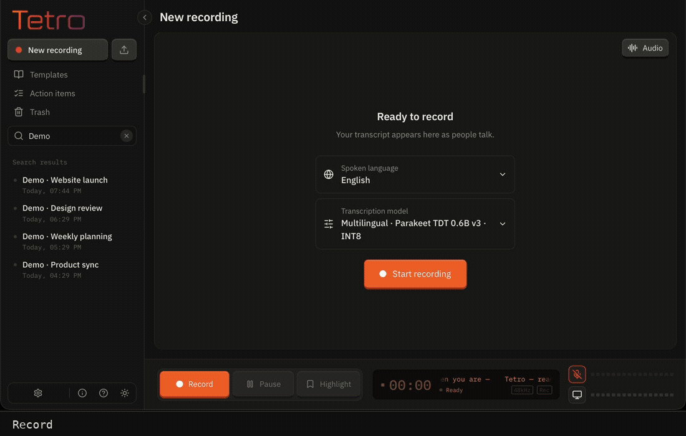

# Tetro

Tetro is developed by Vana Labs.

Tetro is a desktop app for recording meetings, transcribing audio, and turning
conversations into editable summaries and action items. It can use local models for
transcription and summaries. If you choose an external AI provider, the content
needed for that request is sent to that provider.



Record, transcribe, choose a summary template, and write a summary with action items.
[Download video (MP4)](https://github.com/VanaLabs/tetro/raw/refs/heads/main/docs/media/tetro-demo.mp4). This demo uses fictional meeting
audio; recording and processing waits are sped up.

## Source and brand

Project-authored code and written documentation are available under the
[MIT License](LICENSE.md). Third-party components keep their own licenses;
see the notices bundled in the app. The **Tetro** name, wordmark, logos, app
icons, and other identity artwork belong to **Vana Labs** and are
reserved separately. See [BRAND.md](BRAND.md) before distributing a fork.

## Download

| Platform | Download |
| --- | --- |
| Windows 11, Intel or AMD | [Tetro 9.1.12 for Windows x64](https://github.com/VanaLabs/tetro/releases/download/v9.1.12/Tetro_9.1.12_x64-setup.exe) |
| Windows 11, ARM processor | [Tetro 9.1.12 for Windows ARM64](https://github.com/VanaLabs/tetro/releases/download/v9.1.12/Tetro_9.1.12_arm64-setup.exe) |
| Apple Silicon Mac | [Tetro 9.1.12 for macOS](https://github.com/VanaLabs/tetro/releases/download/v9.1.12/Tetro_9.1.12_aarch64.dmg) |

## Install on Windows

1. Choose **x64** for an Intel or AMD processor, or **ARM64** for an ARM processor. You can check **Settings → System → About → System type**.
2. Download the matching `-setup.exe` and run it. Tetro installs for your Windows account.
3. Open **Tetro** and complete setup to download your transcription and summary models.

Windows 11 is required. The installers have signed updater packages but no Windows Authenticode publisher certificate, so Windows may show an unknown-publisher or SmartScreen notice. Use only the files from **VanaLabs/tetro**; their checksums are in `SHA256SUMS` on the release page. Do not disable Windows security globally.

## Install on your Mac

1. Download **Tetro_9.1.12_aarch64.dmg** from the assets below. Choose the DMG, not “Source code” or the updater archive.
2. Open the downloaded DMG, then **drag Tetro onto Applications** in that window. Wait for the copy to finish.
3. Open **Finder → Applications → Tetro**. You can eject the Tetro disk image afterward.
4. If macOS says Apple cannot check Tetro or the developer cannot be verified, dismiss that message with **Done** (or **OK**, depending on macOS). Keep the app in Applications.
5. Open **Apple menu  → System Settings → Privacy & Security**. Scroll down to **Security**. Find the message about Tetro being blocked and click **Open Anyway**.
6. Confirm with your Mac password or Touch ID if asked, then click **Open** in the confirmation. Tetro’s setup should appear.

**Don’t see Open Anyway?** First try opening Tetro from Applications once, then return to Privacy & Security. The button appears after macOS blocks a launch. A managed work Mac may require help from its administrator.


*Screenshot: Apple Support. “Example App” will be “Tetro” on your Mac; the layout may differ by macOS version.* [Apple’s full instructions](https://support.apple.com/en-us/102445).

Tetro is ad-hoc signed and not Apple-notarized. These steps apply to the unidentified-developer warning for your download from **VanaLabs/tetro**. If macOS instead reports malware or a damaged app, stop and report the exact message.

This installer is for **Apple Silicon Macs**. Computer-audio capture requires macOS 14.4 or later.

Onboarding helps you set up permissions and download Parakeet for transcription
and Qwen 3.5 2B for summaries. This release includes Windows x64, Windows ARM64
and Apple Silicon macOS installers. Intel Mac and Linux installers are not included.

## Source layout

The frontend is in `frontend/src/`, and the native Tauri app is in
`frontend/src-tauri/`. This repository holds the consumer app source. Model
weights and platform-specific sidecar executables are not committed. A native
build needs those resources in the paths listed in
`frontend/src-tauri/tauri.conf.json`.

From `frontend/`, the main checks are:

```sh
pnpm typecheck
pnpm test
pnpm build
```

The Rust tests run from the repository root:

```sh
cargo test --lib --manifest-path frontend/src-tauri/Cargo.toml
```

The original copyright notice and third-party license notices remain in
[LICENSE.md](LICENSE.md) and the app's Licenses panel.

## Releases and updates

The app checks GitHub Releases and lets users choose when to download and
install updates. Release builds need signed updater artifacts and `latest.json`;
a source push alone does not update installed apps. See
[the release guide](docs/RELEASING.md) for packaging, signing, and publication.
Updater packages are signed separately from Apple code signing. An end-to-end
upgrade from the first release is still pending validation.

## Privacy

Recordings, transcripts, and summaries are stored locally. Downloading a model
contacts its distributor. External AI providers process the content you send
to them. Read [the privacy policy](PRIVACY_POLICY.md) and the app's provider
settings before using an external service.

## Contributing

Issues and patches are welcome. See
[CONTRIBUTING.md](CONTRIBUTING.md). Contributions to the project code are under
MIT; contributions do not grant rights to the Tetro brand.
